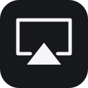

# AirPlay & Remote Receiver

Mirror your iPhone, iPad or Mac to Android TV, stream audio, and control your TV
with the Apple TV Remote in iPhone Control Center.

[](https://github.com/henry753951/airplay-remote-receiver/actions/workflows/build.yml)
[](LICENSE)

**[Download APK · v0.2.0-rc5](https://github.com/henry753951/airplay-remote-receiver/releases/tag/v0.2.0-rc5)** ·
[All releases](https://github.com/henry753951/airplay-remote-receiver/releases) ·
**[繁體中文](docs/README.zh-TW.md)** · [Contributing](CONTRIBUTING.md)

## Features

- AirPlay screen mirroring and audio streaming.
- Apple TV Remote support without an additional iPhone app.
- Mac extended desktop, when supported by the sender.
- A TV interface with clear remote focus, smooth transitions and on-screen pairing.
- English and Traditional Chinese.
- One TV name for casting and remote control.
- Background reception, optional startup at boot and supported display wake.
- Picture, audio, remote control and power settings.

## Requirements

- Android 8.0 / API 26 or newer.
- ARM 32-bit (`armeabi-v7a`).
- The TV and Apple device connected to the same network, with device discovery allowed.

## Get started

1. Install the signed APK from [Releases](https://github.com/henry753951/airplay-remote-receiver/releases) and open **AirPlay & Remote Receiver** on the TV.
2. Choose a TV name in **Settings** and complete the on-screen permission prompts.
3. On iPhone or iPad, open **Control Center → Screen Mirroring** and choose your TV.
4. Enter the pairing code shown on the TV.

On Mac, choose the TV in **Control Center → Screen Mirroring**. For an extended
desktop, open **System Settings → Displays** and select the extended-display mode
if available.

### Use iPhone as a remote

Open **Control Center → Apple TV Remote**, choose your TV and enter its pairing code.
Complete the TV's control authorization when prompted. Some TVs require debugging
to be enabled in developer settings before remote navigation is available.

For arrow buttons, enable **Settings → Accessibility → Apple TV Remote → Directional
Buttons** on iPhone. Options vary by iOS version; see [Apple's guide](https://support.apple.com/en-gb/guide/iphone/iph2ec3a3aa6/ios).

## Settings

- **Picture:** resolution, frame rate and color options.
- **Audio:** volume and buffering.
- **Remote:** pairing and TV control.
- **Power:** background reception, startup and standby preferences.

## Compatibility

Playback quality, supported codecs and remote features vary by TV firmware and
Apple device version. Some TVs may not reproduce near-black or near-white shades
correctly during mirroring. DRM-protected video is unsupported.

Background reception and display wake require a TV that keeps networking available
in standby. Reception is unavailable when the TV is fully powered off or unplugged.

## Build

The project uses the checked-in Gradle wrapper and dependency catalog.

| Tool | Version |
| --- | --- |
| JDK | 21 |
| Rust | 1.98.0; target `armv7-linux-androideabi` |
| Gradle / Android Gradle Plugin | 9.8.1 / 9.4.1 |
| Android SDK platform | 37.0 |
| Android NDK | 27.0.12077973 |
| CMake | 3.22.1 |

Install the listed SDK components, set `ANDROID_HOME`, then:

```sh
git clone --recurse-submodules https://github.com/henry753951/airplay-remote-receiver.git
cd airplay-remote-receiver
# Optional toolchain provisioning with mise: mise trust && mise install
rustup target add armv7-linux-androideabi
scripts/build-remote.sh
(cd remote && cargo test --locked -p atv-core)
./gradlew :app:testDebugUnitTest :app:assembleRelease :app:lintRelease --max-workers 4
```

The unsigned APK is in `app/build/outputs/apk/release/`. Sign it with your own
release key before installation, or use `assembleDebug` for development.
Complete release source archives include the pinned native dependencies and can
be built with the same Rust and Gradle commands. Git is required to apply the included patches.
See [release instructions](docs/RELEASING.md).

## License and credits

GPL-3.0; see [LICENSE](LICENSE) and [third-party notices](THIRD_PARTY_NOTICES.md).
Based on [jqssun/android-airplay-server](https://github.com/jqssun/android-airplay-server),
with UxPlay providing AirPlay/RAOP protocol support. Remote reception includes
[corvofeng/atv-core](https://github.com/corvofeng/atv-core) and protocol work based on pyatv. Independent project; not
affiliated with or endorsed by Apple Inc.
