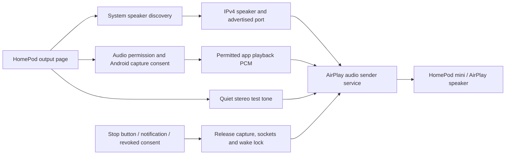

# HomePod audio output

Android TV AirPlay Hub keeps screen mirroring and iPhone remote reception in the
same application and adds an independent, experimental audio sender. No Apple TV
is required for this sender path. It does not change other players or TV firmware.

## Implemented flow

1. **Discover:** the system NSD client browses `_airplay._tcp.`. Resolutions are
   serialized for older Android versions, disappearances remove entries, and the
   browser releases its multicast lock when the page leaves. Users select speakers
   by name; addresses and ports come from discovery, with no manual network fields.
   IPv6 is not implemented.
2. **Test:** the service generates a quiet 440 Hz stereo tone at 44.1 kHz. The
   reference amplitude is bounded to 8000/32767 and the initial speaker volume is 25%; volume adjustment and stopping are available
   in the page, with stopping also available in the foreground notification.
3. **Capture:** Android 10+ needs `RECORD_AUDIO` and a new MediaProjection consent
   token. The capture service enters the media-projection foreground type before
   using the token, registers a revocation callback, and requests playback audio
   through `AudioPlaybackCaptureConfiguration`. It never selects a microphone.
   Only media/game/unknown usages are matched. Source applications and the OS
   retain control over capture eligibility.
4. **Send:** the adapted AirBridge sender performs transient pairing, session
   setup, ALAC packet encoding, encrypted transport, timing and loss handling.
   Captured 44.1/48 kHz stereo PCM is fed to its bounded ring buffer; the sender
   converts to 44.1 kHz as needed and uses audio hardware clock estimates to
   compensate for drift. The upstream stable buffering policy is retained.
5. **Stop:** user stop, consent revocation, capture failure, connection failure
   or a 60-second connection timeout ends the session. Cleanup runs off the main
   thread; session-held CPU and Wi-Fi locks are released with it. Stale callbacks
   cannot update a newer service session. The sender does not auto-start at boot or re-use capture consent after process death.

## Source boundaries

| File | Responsibility |
| --- | --- |
| `ui/HomePodScreen.kt` | Remote-friendly speaker selection and consent launchers |
| `audiooutput/SpeakerDiscovery.kt` | NSD browsing and sequential resolution |
| `audiooutput/HomePodOutputService.kt` | Foreground lifetime, status, stop and resource ownership |
| `audiooutput/PlaybackCapture.kt` | Playback-only PCM capture and hardware-rate estimates |
| `audiooutput/TestTone.kt` | Continuous, bounded stereo test samples |
| `audiooutput/protocol/` | Adapted AirBridge transport, codec, crypto and clock |

Only protocol state and numeric stream counters are forwarded to Android logs;
pairing payloads, endpoint names and source audio are excluded. Captured PCM is
kept in memory and sent to the chosen local-network endpoint; it is not written
to files or uploaded to a service. NSD announcements are untrusted: endpoints,
ports, response sizes and binary plist references are validated.

The application ID, settings files, controller records and receiver JNI names
remain unchanged. Updating an existing installation still requires its original
signing key. Existing receiver startup and disconnect preferences do not control
the sender; stopping speaker output leaves the receivers available.

## Device validation

Build and unit/lint checks validate packaging and the tested protocol primitives;
they do not establish HomePod firmware compatibility or acoustic output. For a
physical test:

1. Put the TV and HomePod mini on the same LAN, enable speaker access from that
   network in the Home app, and open **HomePod audio output** on the TV.
2. Select the advertised speaker and play the test tone. Confirm actual sound,
   volume changes and stopping at the speaker.
3. Start app audio, approve Android's permission and capture dialogs, then open
   a player with an unprotected local audio/video sample that allows capture.
   Confirm sound at HomePod and observe any video or TV-speaker delay.
4. Revoke capture from the system controls, stop from the app and notification,
   and disconnect the speaker network. Confirm capture/notification cleanup and
   that a new session can start. Recheck mirroring and iPhone remote reception.

The current alpha has not completed this physical-device checklist. A streaming
status means the protocol session started; it does not prove that captured audio
is non-silent or that the speaker is audible.

## Limits

- Playback capture can be disabled by the player, DRM or TV firmware. This
  implementation does not override those restrictions.
- AirPlay buffering introduces delay. Automatic video delay compensation and
  synchronization with the TV speakers are not implemented.
- Output is full-range stereo. Low-pass filtering/subwoofer mode, stereo groups,
  PIN/password pairing and persistent pairing storage are not implemented.
- The existing app remains compatible with Android 8+, but playback capture
  requires Android 10+. Packaged native receivers target ARMv7.

The sender is adapted from Apache-2.0
[AirBridge at 12d4fa7](https://github.com/kerrybob46644-commits/AirBridge/tree/12d4fa781b86aaac6135e9279044d8a0f81fce21).
Attribution and full license text are included in the repository and APK. See
[third-party notices](../THIRD_PARTY_NOTICES.md).
